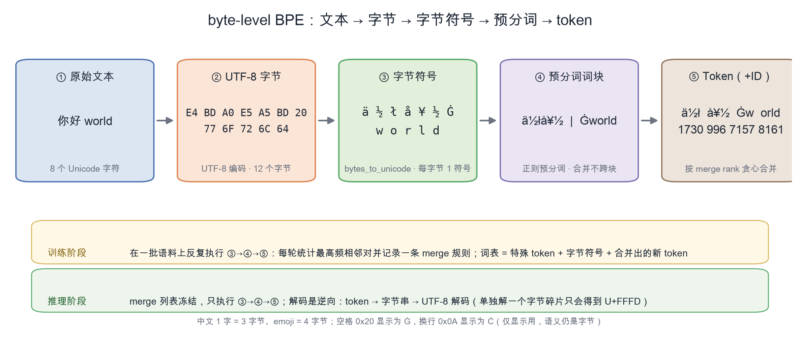
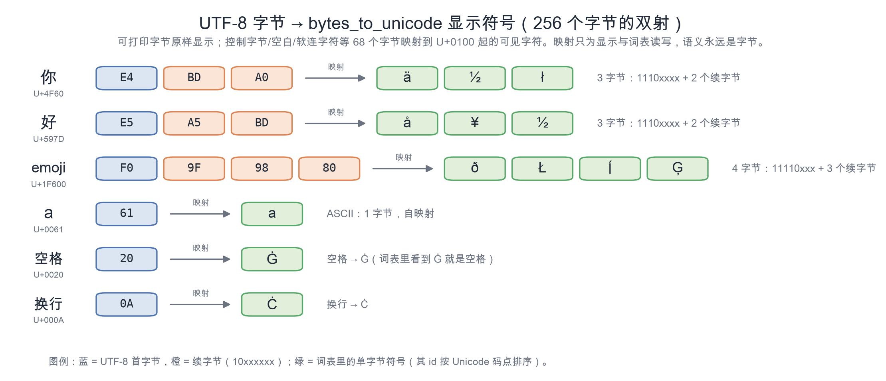
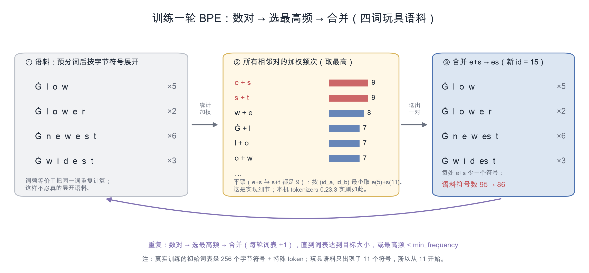
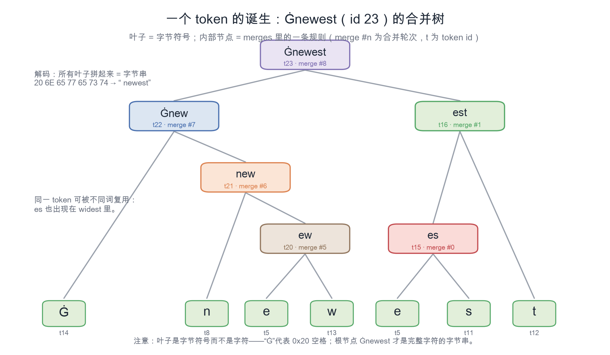
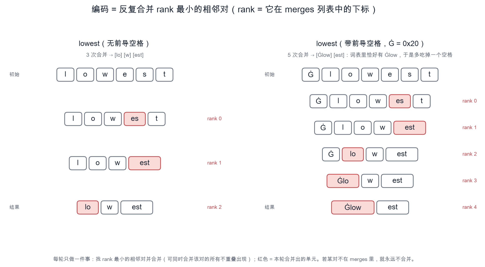
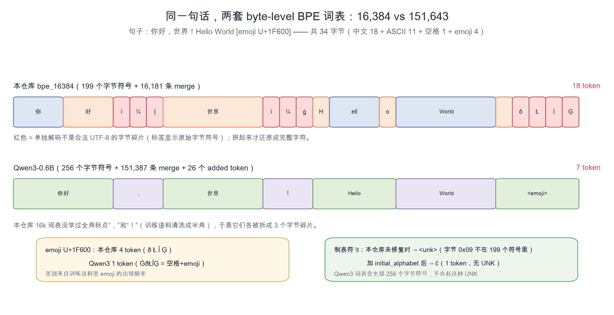

# byte-level BPE 详解：从字节到 token（图文 + 可运行实现）

> 面向：已经跑过 Stage 3、想彻底搞懂 `tokenizers` 里 `ByteLevel + BPE` 到底在做什么的读者。
> 本文所有数字都来自本仓库实测（Apple M4 Pro、`tokenizers` 0.23.3、Stage 3 的 3,000 篇中文维基语料），
> 每条结论都注明了验证方式，不引用未验证的“常识”。配套插图在 [`figures/`](figures/)，
> 生成脚本为 [`figures/make_figures.py`](figures/make_figures.py)。

## 目录

- [0. 一页速览](#0-一页速览)
- [1. 为什么是 byte-level](#1-为什么是-byte-level)
- [2. 第一层：UTF-8 字节与 bytes_to_unicode](#2-第一层utf-8-字节与-bytes_to_unicode)
- [3. 预分词：合并只能发生在词块内部](#3-预分词合并只能发生在词块内部)
- [4. 训练算法](#4-训练算法)
- [5. 编码（推理）算法](#5-编码推理算法)
- [6. 解码](#6-解码)
- [7. 本仓库实测：结构、压缩率、UNK 陷阱、对拍验证](#7-本仓库实测结构压缩率unk-陷阱对拍验证)
- [8. 与其它分词算法对比](#8-与其它分词算法对比)
- [9. 工程陷阱清单](#9-工程陷阱清单)
- [10. 从零实现（完整代码）](#10-从零实现完整代码)
- [11. 延伸阅读](#11-延伸阅读)
- [附录 A：数字怎么复现](#附录-a数字怎么复现)
- [附录 B：四个常见疑问（FAQ）](#附录-b四个常见疑问faq)
- [附录 C：bytes_to_unicode 完整映射表（256 项）](#附录-cbytes_to_unicode-完整映射表256-项)
- [附录 D：OOV / UNK 实测与检查清单](#附录-doov--unk-实测与检查清单)

---

## 0. 一页速览



*图 1：byte-level BPE 的五步流水线；训练时学 merge 规则，推理时只应用规则。*

一句话：**byte-level BPE 把文本先变成 UTF-8 字节序列（256 个基础符号），再用“反复合并最高频相邻符号对”的方式学出子词表。**
它把“未登录词”问题变成了“未登录字节”问题——只要 256 个字节都在词表里，任何文本都能无损编码。

三组关键数字：

| 事实 | 数值 | 来源 |
|---|---|---|
| 基础符号（字节） | 256 | 定义 |
| GPT-2 词表 | 50,257 = 256 字节 + 50,000 merges + 1 个特殊 token | GPT-2 论文/官方代码 |
| 本仓库 `bpe_16384` | 16,384 = 4 特殊 token + 199 个字节符号 + 16,181 merges | `data/processed/stage3/tokenizers/bpe_16384/tokenizer.json` |
| 本仓库 `bpe_32768` | 32,768 = 4 + 199 + 32,565 | 同上（32k 版） |
| Qwen3-0.6B 词表 | 151,643 = 256 字节符号 + 151,387 merges（另有 26 个 added token） | `models/Qwen3-0.6B/tokenizer.json` |

核心循环只有 4 行伪代码（训练阶段）：

```text
repeat:
    统计语料中所有相邻符号对的加权频次（词频即权重）
    取频次最高的对 (a, b)，在词表里登记新符号 a+b（并记录一条 merge 规则）
    把语料中所有出现 (a, b) 的位置替换成 a+b
until 词表达到目标大小，或最高频次 < min_frequency
```

编码阶段不再统计，而是**按 merge 规则的学习顺序（rank）从低到高贪心地应用**。下面逐层展开。

---

## 1. 为什么是 byte-level

分词粒度有四类做法，各有各的麻烦：

| 粒度 | 基础符号 | 未登录词（OOV） | 序列长度（中文） | 代表模型 / 问题 |
|---|---|---|---|---|
| 词级 | 几十万～上百万个词 | 严重：新词、拼写错误、emoji、形态变化都 OOV | 短 | 经典 NLP；词表爆炸，中文分词还要先分词 |
| 字符级 | Unicode 字符 | 仍存在：Unicode 有 14 万+ 字符且持续新增，低频字符必 OOV | 1 token/汉字 | 早期 char-CNN；序列长、注意力开销大 |
| 字符级 BPE（子词） | Unicode 字符 | 仍可能 OOV（罕见字符、新 emoji） | 1–2 token/汉字 | SentencePiece BPE（Llama 2，配 byte fallback） |
| **byte-level BPE** | **256 个字节（闭集）** | **理论为 0**（256 个字节全在词表时） | 先 3 个符号/汉字，靠 merge 合回来 | GPT-2/3/4、Qwen、Llama 3 |

byte-level 的取舍非常明确：

- **收益**：基础符号集合是闭集，任何 UTF-8 文本（含 emoji、任何语言、乱码）都能无损表示；
  一套算法、一套词表结构通吃所有语言；不再需要 UNK（只要字节都在词表里）。
- **代价**：非 ASCII 字符先被拆成 2–4 个字节符号，早期 token 序列更“碎”；
  必须靠语料训练把常见字节串合并回有意义的 token。所以 **byte-level BPE 的压缩率高度依赖训练语料**：
  英文常见词通常 1 token，中文常见词 1–2 token，而训练语料里没见过的 emoji 可能要 4 token。

> 本文讨论的 byte-level BPE 特指 GPT-2 系（`bytes_to_unicode` + 正则预分词 + BPE）实现，
> 也是本仓库 `tokenizers` 配置和 Qwen 系列采用的方案。注意它和 Llama 2 的
> “SentencePiece BPE + byte fallback”不是一回事，见 [§8](#8-与其它分词算法对比)。

---

## 2. 第一层：UTF-8 字节与 bytes_to_unicode

### 2.1 文本 → UTF-8 字节

UTF-8 把一个 Unicode 码点编码成 1–4 个字节：ASCII 1 字节，拉丁/希腊/西里尔等 2 字节，
中日韩等 3 字节，emoji 等 4 字节。首字节高位带长度信息，续字节一律以 `10` 开头：



*图 2：UTF-8 字节与 `bytes_to_unicode` 显示符号的对应关系。*

| 字符 | 码点 | UTF-8 字节 | 字节符号（显示用） |
|---|---|---|---|
| `你` | U+4F60 | `E4 BD A0` | `ä ½ ł` |
| `好` | U+597D | `E5 A5 BD` | `å ¥ ½` |
| `😀` | U+1F600 | `F0 9F 98 80` | `ð Ł ĺ Ģ` |
| `a` | U+0061 | `61` | `a` |
| 空格 | U+0020 | `20` | `Ġ` |
| 换行 | U+000A | `0A` | `Ċ` |

因此 “你好 world” 的字节序列是 12 个字节，而 “你好” 两个字就占 6 个基础符号：

```text
"你好 world"  →  E4 BD A0 E5 A5 BD 20 77 6F 72 6C 64
                →  ä ½ ł å ¥ ½ Ġ w o r l d
```

### 2.2 为什么还要 bytes_to_unicode：字节不能直接当字符用

如果直接把每个字节 `chr(b)` 当成词表符号，会同时踩三个坑：

1. **不可打印**：0x00–0x1F 是控制字符，0x7F 是 DEL，还有 C1 控制符；写进 `tokenizer.json` 会变成
   `\u0000` 之类的转义，调试、diff、序列化都很难看，也容易和真正的 Unicode 文本混淆。
2. **空白与“看不见的字符”**：空格、换行、制表符、软连字符（0xAD）在词表里肉眼不可见，
   无法确认 token 边界，也无法确认某个 token 到底是不是空格。
3. **和 Unicode 语义纠缠**：字节 0x80–0xFF 单独拿出来也是合法 Unicode 码点（如 `ä`、`½`），
   但它们和 UTF-8 里的字符没有任何关系；直接用会让“词表里的字符”和“文本里的字符”混淆。

GPT-2 的做法是构造一个**双射** `bytes_to_unicode()`：把 256 个字节映射到 256 个互不相同的、
可打印、易于显示的 Unicode 字符。实现只有十来行：

```python
def bytes_to_unicode() -> dict[int, str]:
    """GPT-2 的可逆字节→可见字符映射：256 个字节 ↔ 256 个 Unicode 字符。"""
    bs = list(range(ord("!"), ord("~") + 1))      # 33..126：ASCII 可打印
    bs += list(range(ord("¡"), ord("¬") + 1))      # 161..172：Latin-1 可打印
    bs += list(range(ord("®"), ord("ÿ") + 1))      # 174..255：Latin-1 可打印
    cs = bs[:]
    n = 0
    for b in range(256):
        if b not in bs:                            # 0..32、127..160、173（软连字符）
            bs.append(b)
            cs.append(256 + n)                     # 依次映射到 U+0100 起
            n += 1
    return dict(zip(bs, map(chr, cs)))
```

映射结果：**188 个可打印字节原样自映射**（`!`…`~`、`¡`…`¬`、`®`…`ÿ`），
剩下 **68 个不可打印/空白/控制字节**（0–32、127–160、173）映射到 U+0100–U+0143。
完整的 256 项映射见 [附录 C](#附录-cbytes_to_unicode-完整映射表256-项)。最常见的几个：

| 字节 | 十六进制 | 显示符号 | 说明 |
|---|---|---|---|
| 32 | `20` | `Ġ` | 空格（词表里几乎每个“词首”token 都以它开头） |
| 10 | `0A` | `Ċ` | 换行 |
| 9 | `09` | `ĉ` | 制表符 |
| 0 | `00` | `Ā` | NUL |
| 173 | `AD` | `Ń` | 软连字符 |

于是 `"你好"` 的字节 `E4 BD A0 E5 A5 BD` 显示为 `ä½łå¥½`——看起来像乱码，
但这只是 6 个字节符号的“可视化转写”，**没有任何字符语义**。解码时按相反方向
`CHAR_TO_BYTE` 变回字节，再 `bytes.decode("utf-8")` 就还原成 `你好`。

> 记住这一点，后面所有 `Ġ`、`ä½ł` 都不再奇怪：**token 是字节串，不是字符串**。

---

## 3. 预分词：合并只能发生在词块内部

在统计相邻对之前，byte-level BPE 会先按一条正则把文本切成“词块”（pre-token），
BPE 合并**永远不跨词块边界**。GPT-2 的正则是（`tokenizers` 的 `ByteLevel` 预分词器默认使用它）：

```text
's|'t|'re|'ve|'m|'ll|'d| ?\p{L}+| ?\p{N}+| ?[^\s\p{L}\p{N}]+|\s+(?!\S)|\s+
```

逐段解释：

| 分支 | 作用 | 例子 |
|---|---|---|
| `'s\|'t\|'re\|'ve\|'m\|'ll\|'d` | 英文缩写单独成块 | `I'm` → `["I", "'m"]` |
| ` ?\p{L}+` | 可选前导空格 + 连续字母（含汉字等所有字母类字符） | `" world"` → `[" world"]` |
| ` ?\p{N}+` | 可选前导空格 + 连续数字 | `" 42"` → `[" 42"]` |
| ` ?[^\s\p{L}\p{N}]+` | 可选前导空格 + 连续标点/符号 | `"!!!"` → `["!!!"]` |
| `\s+(?!\S)` | 一段空白，其后面不再接非空白（即位于文本尾，或后面仍是空白） | 行首的 `"  leading"` → `[" ", ...]` |
| `\s+` | 兜底空白（前一分支不匹配时） | `"a\n\nb"` 的第二个 `\n` |

实测切分（`regex` 模块，与 `tokenizers` 行为一致）：

```text
'Hello world!'        -> ['Hello', ' world', '!']
"  leading spaces"    -> [' ', ' leading', ' spaces']
'你好，世界！'          -> ['你好', '，', '世界', '！']
"I'm 42 years old"    -> ['I', "'m", ' 42', ' years', ' old']
'a\n\nb'              -> ['a', '\n', '\n', 'b']
```

为什么一定要预分词：

1. **避免跨词合并**：若不切分，`"the cat"` 里的 `e c` 这样的跨词对也可能被合并，词表会被
   “跨词碎片”污染，语义单元变差。
2. **控制空格语义**：` ?\p{L}+` 把**一个**前导空格粘进词块，于是 `Hello` 和 ` Hello` 是两个不同的词块，
   token 也不同（`H` vs `ĠH`），这对生成时的空格控制至关重要。
3. **控制压缩率与序列长度**：预分词边界越细（如中文按字切），可学的跨边界组合越少，token 越多；
   边界越粗，压缩率上限越高但词表越容易学到“整句”这种不泛化的 token。

**不同模型的预分词正则不同，这就是不同 tokenizer 不可混用的根本原因之一。**
Qwen3-0.6B 的 `tokenizer.json` 里实际是 `Split` + `ByteLevel(use_regex=false)` 两段（本机读取确认）：

```text
(?i:'s|'t|'re|'ve|'m|'ll|'d)|[^\r\n\p{L}\p{N}]?\p{L}+|\p{N}| ?[^\s\p{L}\p{N}]+[\r\n]*|\s*[\r\n]+|\s+(?!\S)|\s+
```

它把数字拆成单个 `\p{N}`、把换行与前面的标点/空白绑定，因此对中文、代码、数字的切分都与 GPT-2 不同。
（GPT-4 的 cl100k 又会把数字切成最多 3 位一组——这里不展开，关键是：**正则变了就是另一个分词器**。）

对中文这种无空格语言，连续汉字会被 `\p{L}+` 整段吞进同一个词块，因此**合并可以跨字**，
例如本仓库 16k 词表里 `世界` 就是一个 token（`ä¸ĸçķĮ`，6 字节）。标点单独成块，
所以全角标点不会和相邻汉字合并。

---

## 4. 训练算法

### 4.1 形式化描述

输入：语料 $C$（字符串列表）；目标词表大小 $V$；最小频次 $m$；特殊 token 列表 $S$。

1. **预分词 + 计数**：把语料切成词块，统计每个词块的出现频次。得到
   $W=\{(w_i, c_i)\}$，其中 $w_i$ 是词块，$c_i$ 是频次。
2. **字节化**：每个词块 $w_i$ 变成符号序列 $s_i = [b_1, b_2, \dots, b_{L_i}]$（UTF-8 字节 → 显示符号）。
3. **初始化词表**：$V_0 = S \cup A$，$A$ 是基础字母表——理论上取全部 256 个字节符号；
   HuggingFace `BpeTrainer` 默认只取**语料中出现过的**字节符号（除非显式传 `initial_alphabet`，见 §7.3）。
   每个符号的 id 按插入顺序分配。
4. **迭代合并**：对每一轮 $t$，

$$
p^* = \arg\max_{(a,b)} \; c(a,b), \qquad c(a,b)=\sum_i c_i \cdot \#\{(j): (s_i[j],s_i[j+1])=(a,b)\}
$$

   若最高频次 $< m$，或词表已满 $|V_t| \ge V$，停止。
   否则在词表登记新符号 $a{+}b$（id = 当前词表大小），记录 merge 规则 $(a,b)$，
   并把所有词块里**从左到右、不重叠**出现的 $(a,b)$ 替换成新符号。
5. 输出：按 id 顺序的 `vocab`，以及按学习顺序排列的 `merges`。

> **为什么“最高频”合理**：每合并一次 $(a,b)$，语料的总符号数减少 $c(a,b)$。
> 所以 BPE 训练是在做“贪心压缩”——每轮选当前能带来最大压缩收益的合并。
> 这与 Re-Pair 压缩算法同源，只是 BPE 把它用在自然语言语料上（Sennrich 等 2016 的 subword 版本）。

**平票规则**：当多个对的频次并列最高时，不同实现的选择不同（见 §4.4）。
本文的实现与 HuggingFace `tokenizers` 实测行为一致：**取 $(id_a, id_b)$ 字典序最小的对**。

### 4.2 训练一轮长什么样



*图 3：训练一轮的三个动作——数对、选最高频、合并并更新语料。*

### 4.3 完整手算示例（与 `tokenizers` 结果逐条一致）

为了看清每一步，用一个只有 4 个词的小语料（词块已含前导空格，`Ġ` = 0x20）：

| 词块 | 字节符号序列 | 词频 |
|---|---|---|
| ` low` | `Ġ l o w` | 5 |
| ` lower` | `Ġ l o w e r` | 2 |
| ` newest` | `Ġ n e w e s t` | 6 |
| ` widest` | `Ġ w i d e s t` | 3 |

初始字母表 = 语料中出现过的 11 个字节符号，按 Unicode 码点排序编号（与 `tokenizers` 的分配一致）：

| 符号 | `d` | `e` | `i` | `l` | `n` | `o` | `r` | `s` | `t` | `w` | `Ġ` |
|---|---|---|---|---|---|---|---|---|---|---|---|
| id | 4 | 5 | 6 | 7 | 8 | 9 | 10 | 11 | 12 | 13 | 14 |

（id 0–3 是 `<pad> <bos> <eos> <unk>`。）目标词表大小设为 27 = 4 + 11 + 12，即训练 12 轮 merge。

第 1 轮统计（加权频次，降序）：

```text
e+s: 9   s+t: 9   w+e: 8   Ġ+l: 7   l+o: 7   o+w: 7   Ġ+n: 6   n+e: 6
e+w: 6   Ġ+w: 3   w+i: 3   i+d: 3   d+e: 3   e+r: 2
```

`e+s` 和 `s+t` 并列 9，按“id 字典序最小”取 `e(5)+s(11)`。

完整 12 轮（“平票数”= 该轮并列最高的候选对数；“符号数”= 语料总符号数，含词频权重）：

| 轮次 | 选中的对 | id | 频次 | 平票数 | 新 token（id） | 符号数 |
|---|---|---|---|---|---|---|
| 0 | `e` + `s` | (5, 11) | 9 | 2 | `es` (15) | 95 → 86 |
| 1 | `es` + `t` | (15, 12) | 9 | 1 | `est` (16) | 86 → 77 |
| 2 | `l` + `o` | (7, 9) | 7 | 3 | `lo` (17) | 77 → 70 |
| 3 | `Ġ` + `lo` | (14, 17) | 7 | 2 | `Ġlo` (18) | 70 → 63 |
| 4 | `Ġlo` + `w` | (18, 13) | 7 | 1 | `Ġlow` (19) | 63 → 56 |
| 5 | `e` + `w` | (5, 13) | 6 | 4 | `ew` (20) | 56 → 50 |
| 6 | `n` + `ew` | (8, 20) | 6 | 3 | `new` (21) | 50 → 44 |
| 7 | `Ġ` + `new` | (14, 21) | 6 | 2 | `Ġnew` (22) | 44 → 38 |
| 8 | `Ġnew` + `est` | (22, 16) | 6 | 1 | `Ġnewest` (23) | 38 → 32 |
| 9 | `d` + `est` | (4, 16) | 3 | 4 | `dest` (24) | 32 → 29 |
| 10 | `i` + `dest` | (6, 24) | 3 | 3 | `idest` (25) | 29 → 26 |
| 11 | `w` + `idest` | (13, 25) | 3 | 2 | `widest` (26) | 26 → 23 |



*图 4：`Ġnewest` 的合并树——叶子是字节符号，内部节点是 merge 规则；同一 token 可被不同词复用。*

中途状态（每行是一个词块的当前符号序列）：

| 阶段 | ` low` | ` lower` | ` newest` | ` widest` |
|---|---|---|---|---|
| 初始 | `Ġ l o w` | `Ġ l o w e r` | `Ġ n e w e s t` | `Ġ w i d e s t` |
| 完成 3 次 merge（rank 0–2） | `Ġ lo w` | `Ġ lo w e r` | `Ġ n e w est` | `Ġ w i d est` |
| 完成 5 次 merge（rank 0–4） | `Ġlow` | `Ġlow e r` | `Ġ n e w est` | `Ġ w i d est` |
| 完成 8 次 merge（rank 0–7） | `Ġlow` | `Ġlow e r` | `Ġnew est` | `Ġ w i d est` |
| 完成 12 次 merge（rank 0–11） | `Ġlow` | `Ġlow e r` | `Ġnewest` | `Ġ widest` |

观察：

- 前两轮合并 `e+s`、`es+t`，是因为 `est` 同时出现在 `newest`、`widest` 里，**共享后缀频次最高**；
- `Ġlow` 能成为 token，是因为 ` low` 和 ` lower` 共享前缀，频次 7；
- 最后几个 merge（`dest`、`idest`、`widest`）只服务 `widest`，频次降到 3——说明**语料中低频的模式只能靠高频共享对“顺带”学出来**，这也是为什么语料规模决定词表质量；
- 12 轮后词表达到 27，训练停止。此时还剩 `e+r`（频次 2）、`Ġ+widest`（频次 3）等可合并对，只是词表已经满了——
  这演示了**停止条件由词表大小决定**，而不是“合无可合”；若把目标词表调大，下一轮会先合并 `Ġ+widest`。

### 4.4 平票：一个真实存在的实现细节

`e+s` 与 `s+t` 都出现 9 次，选谁？不同实现答案不同：

- **本机 `tokenizers` 0.23.3**：取 token id 字典序最小的对，即 `e(5)+s(11)`。
  我把这个规则写进模拟器，在 20 个随机小语料上重放，**20/20 与 `tokenizers` 的 merges 完全一致**；
  同一语料换行序训练 4 次（含跨进程）结果也完全一致。
- 若改成人眼更直觉的“最早出现的对优先”，上面 12 轮的 merge 序列会变成
  `es, est, Ġl, Ġlo, Ġlow, Ġn, Ġne, Ġnew, Ġnewest, Ġw, Ġwi, Ġwid`——从第 3 条 merge（rank 2）开始就不同了。

结论：**“最高频”只定义了候选集，平票规则是算法规格的一部分**。
需要可复现的分词器时，要么固定实现版本，要么在训练器里显式规定平票顺序
（本仓库的做法是：训练一次、保存 `tokenizer.json`，后续只加载不重训）。

### 4.5 停止条件与词表账本

`tokenizers.BpeTrainer` 的 `vocab_size` 是**最终词表总大小**（含特殊 token），训练在以下任一条件停止：

1. `len(vocab) >= vocab_size`（实际通常正好相等）；
2. 最高频次 `< min_frequency`；
3. 没有可合并的相邻对了（所有词块都已被合并成单符号，或语料太小）。

在词表学满目标大小的情形下，`merges` 条数 = `vocab_size - len(special_tokens) - len(实际入表的字节符号数)`。本仓库：

```text
16384 - 4 - 199 = 16181   ← bpe_16384 的 merges 条数
32768 - 4 - 199 = 32565   ← bpe_32768 的 merges 条数
```

如果按“理想 byte-level”（256 个字节全部入表）训练 16384 词表，则 merges 应为
`16384 - 4 - 256 = 16124`。本仓库少了 57 个字节符号，因此多出了 57 条 merge——但代价是那些字节会变成 `<unk>`（见 §7.3）。

### 4.6 复杂度与工程实现

朴素实现的每轮开销 = 扫描全部词块的符号序列（$O(\sum_i L_i)$），总开销
$O(R \cdot \sum_i L_i)$，$R$ 为 merge 轮数（本仓库 1.6 万/3.3 万轮）。直接这样做会非常慢。

生产实现（`tokenizers` 的 Rust 版）用了两个关键优化：

1. **pair → 词块倒排索引**：记录每个相邻对出现在哪些词块里；合并时只更新受影响的词块，
   不必全量重扫；
2. **优先队列/最大堆**：增量维护 pair 频次，每轮取最大只需 $O(\log n)$。

实测开销（本机，Stage 3 的 3,000 篇文档、2,245,415 字符）：

| 词表 | 训练耗时 | merges |
|---|---|---|
| 16,384 | 3.35 s | 16,181 |
| 32,768 | 4.54 s | 32,565 |

### 4.7 相关变体

- `initial_alphabet`：显式指定初始字母表（见 §7.3 的修复）；
- `min_frequency`：过滤低频合并，词表较小时防止学到只出现 1 次的“垃圾 token”；
- `max_token_length`：限制单个 token 的最大字节数（防止出现超长 token）；
- **BPE-dropout**（Provilkov 等 2020）：训练时以概率 $p$ 随机跳过某些 merge，
  让同一文本产生不同切分，作为子词正则化；推理时恢复完整 merges。

---

## 5. 编码（推理）算法

### 5.1 rank = 优先级

`merges` 是有序列表，下标就是 **rank**：rank 越小，说明它越早被学到、优先级越高。
编码时反复做：

1. 在当前符号序列里找 rank 最小的相邻对；
2. 合并它（可以一次合并该对的所有不重叠出现，左→右）；
3. 重复直到没有相邻对出现在 merges 里。



*图 5：同一个词根加上前导空格后，编码路径完全不同（3 vs 2 个 token）。*

### 5.2 手算示例

用 §4.3 学到的 12 条 merges（rank 0–11）编码两个词：

```text
"lowest"（无前导空格）
  初始  l o w e s t
  rank0 应用 e+s  →  l o w es t
  rank1 应用 es+t →  l o w est
  rank2 应用 l+o  →  lo w est
  结果  [lo] [w] [est]        （3 token）

" lowest"（带前导空格，词块 = Ġ l o w e s t）
  rank0 e+s   →  Ġ l o w es t
  rank1 es+t  →  Ġ l o w est
  rank2 l+o   →  Ġ lo w est
  rank3 Ġ+lo  →  Ġlo w est
  rank4 Ġlo+w →  Ġlow est
  结果  [Ġlow] [est]          （2 token）
```

两个观察：

- `lowest` 的字母 `l o w e s t` 没在训练语料里作为整词出现过，照样能编码——**BPE 只依赖子串规则**，
  这正是子词分词泛化能力的来源；
- 带不带前导空格结果不同（3 vs 2 token），因为词表里有 `Ġlow` 但没有 `low`。这说明
  **空格不是被忽略的，它是词表语义的一部分**。

> 为什么不能“从左到右见到能合的就合”？因为那样会破坏优先级。经典反例：若 merges 顺序是
> `(a,b)` rank0、`(b,a)` rank1，文本 `abab` 按优先级应得 `[ab][ab]`；若从左往右随便合，
> 可能在位置 1 先合 `(b,a)` 得到 `a[ba]b`。rank 顺序必须遵守。

### 5.3 伪代码

```text
encode(text):
    ids = []
    for part in split_by_special_tokens(text):        # 特殊 token 不参与 BPE
        if part is special_token: ids.append(id(part)); continue
        for chunk in pretokenize(part):                # 同训练时的正则
            symbols = utf8_bytes(chunk) → byte_symbols
            while True:
                pair = argmin_{相邻对 ∈ merges} rank(pair)
                if 不存在: break
                symbols = merge_all_non_overlapping(symbols, pair)
            ids.extend(token_id(s) for s in symbols)
    return ids
```

### 5.4 复杂度与加速

- 单次编码的朴素复杂度是 $O(n^2)$（$n$ 为词块符号数），但词块通常很短
  （一个英文单词、一段连续汉字、一段空白），实际很快；
- `tokenizers` 在 Rust 侧用堆 + 内存池优化，并支持 `encode_batch` 并行；
- **缓存**：同一条文本/同一个词块反复编码时，可缓存 `chunk → ids`；
- 一个反直觉的边界：连续空白可能形成很长的词块（如 100 个空格），此时仍需正确合并——用堆实现可避免退化。

### 5.5 特殊 token 必须先切分

特殊 token（`<pad> <bos> <eos> <unk>`、对话模板里的 `<|im_start|>` 等）在分词前就被
`AddedVocabulary` 识别并切出，**不参与字节化**：

```text
"Hello <eos> world" → ['H', 'ell', 'o', 'Ġ', '<eos>', 'Ġw', 'orld']   （本仓库实测）
```

如果自己实现时忘了这一步，`<eos>` 会被当成普通文本拆成 `<`、`e`、`os`、`>` 四个字节片段——
这是手写 tokenizer 最常见的 bug 之一。

---

## 6. 解码

解码是编码的逆过程，但**不是逐 token 逆变换**：

1. 依次把每个 token 的字符按 `CHAR_TO_BYTE` 还原成字节；
2. 把所有字节拼成一个 `bytes`；
3. 整体做 UTF-8 解码（`errors="replace"`，非法序列替换为 U+FFFD）。

关键在于第 2 步的“整体”：**单个 token 可能不是合法 UTF-8**。本仓库实测：

| token | 字节 | 单独解码 | 拼接后解码 |
|---|---|---|---|
| `ä` | `E4` | `�` | — |
| `ä½` | `E4 BD` | `�` | — |
| `ä½ł` | `E4 BD A0` | `你` | `你` |
| `ä½ł` + `好` | `E4 BD A0 E5 A5 BD` | — | `你好` |

所以：

- **token 不等于字符**，统计 token 数时不能假设“token ≈ 字/词”；
- 逐 token 展示分词结果时看到 `�` 是正常的，因为你在单独解一个字节碎片；
- `decode(encode(text)) == text` 对合法 UTF-8 文本应恒成立（本仓库 16k 分词器在 50 篇文档上实测往返 0 失败）。

特殊 token 的处理：`decode(..., skip_special_tokens=True)` 会跳过；若保留，则按原文插入
（实现见 §10 的 `decode`）。

---

## 7. 本仓库实测：结构、压缩率、UNK 陷阱、对拍验证

### 7.1 词表结构

| 分词器 | vocab | 特殊 token | 单字节符号 | merges | 预分词 | 归一化 |
|---|---|---|---|---|---|---|
| `bpe_16384` | 16,384 | 4（id 0–3） | 199 / 256 | 16,181 | `ByteLevel(add_prefix_space=False)` | 无 |
| `bpe_32768` | 32,768 | 4 | 199 / 256 | 32,565 | 同上 | 无 |
| Qwen3-0.6B | 151,643 | 26 个 added token | 256 / 256 | 151,387 | 自定义 `Split` + `ByteLevel(use_regex=false)` | NFC |

### 7.2 压缩率

Stage 3 的 `evaluate_tokenizer` 用前 200 篇文档评估；注意这 200 篇同时属于训练集的前 3,000 篇
（`documents[:200]` 是 `documents[:3000]` 的子集），所以数字偏乐观。下表补充了**训练集外**
第 3,001–3,200 篇的实测，并加入 Qwen3 分词器作对照：

| 分词器 | 前 200 篇（训练集内） | 3,001–3,200 篇（训练集外） |
|---|---|---|
| `bpe_16384` | 1.464 字符/token | 1.451 字符/token |
| `bpe_32768` | 1.621 字符/token | 1.560 字符/token |
| Qwen3-0.6B | 1.354 字符/token | 1.352 字符/token |

解读：

- 词表翻倍（16k→32k）只带来约 7%–11% 的压缩率提升，但 embedding 参数量翻倍（见 Stage 4 的 S/M/L 档位设计）；
- **词表大不等于本领域压缩率更高**：Qwen3 词表约 9 倍大，但在中文维基上 1.35 字符/token，反而不如
  专门在这 3,000 篇语料上训练的 16k 词表。原因有三：领域匹配、预分词正则不同、Qwen 需覆盖多语言，
  词表容量被摊薄；
- 压缩率不是唯一指标：不同分词器的每 token 困惑度不可比（Stage 7 / `PRINCIPLES.md` 已强调）。

### 7.3 ⚠️ UNK 的真相：本仓库分词器只有 199 个字节符号

HuggingFace `BpeTrainer` **默认不会把 256 个字节全部加入词表**，只加入训练语料中出现过的字节符号。
本仓库分词器的训练语料是清洗后的中文维基（Stage 2 的 `pretrain_zh` 前 3,000 篇），只覆盖了 199 个字节值，缺失的 57 个是：

```text
0–31（换行 0x0A 除外）、64 '@'、94 '^'、95 '_'、127、192、193、200、
220–223、241–255（大多是不会出现在常见 UTF-8 文本里的字节值）
```

后果是这些字节在编码时变成 `<unk>`（id 3）。实测：

```text
"\tHello"      → ['<unk>', 'H', 'ell', 'o']         id = [3, 42, 2547, 79]
"a\r\nb"       → ['a', '<unk>', 'Ċ', 'b']
```

所以 [`docs/stages/03-tokenizer-and-packing.md`](../stages/03-tokenizer-and-packing.md) 里“没有任何 UNK”的说法需要精确化：
**在这批训练/评测语料上 `unk_rate = 0`；但词表并不覆盖全部 256 个字节，域外文本（制表符、回车等）会出 UNK。**

修复方式（本机实测有效）：训练时显式传入完整的字节字母表。

```python
from tokenizers import Tokenizer, decoders, models, pre_tokenizers, trainers

tokenizer = Tokenizer(models.BPE(unk_token="<unk>"))
tokenizer.pre_tokenizer = pre_tokenizers.ByteLevel(add_prefix_space=False)
tokenizer.decoder = decoders.ByteLevel()
trainer = trainers.BpeTrainer(
    vocab_size=16384,
    min_frequency=2,
    special_tokens=["<pad>", "<bos>", "<eos>", "<unk>"],
    initial_alphabet=pre_tokenizers.ByteLevel.alphabet(),   # ← 关键：256 个字节符号全部入表
    show_progress=False,
)
tokenizer.train_from_iterator(texts, trainer=trainer)
```

同一 3,000 篇语料重训后实测：

| | vocab 构成 | `\tHello` | 说明 |
|---|---|---|---|
| 修复前 | 4 + 199 + 16,181 | `['<unk>', 'H', 'ell', 'o']` | 有 UNK |
| 修复后 | 4 + 256 + 16,124 | `['ĉ', 'H', 'ell', 'o']` | 无 UNK |

注意：这会改变整个词表的 id 分配（所有 token id 都会平移），因此**必须重训分词器并重新打包数据、
重新训练模型**，不能只替换文件。本文不建议直接改动现有 `data/processed/stage3/` 产物；
如果只是做“真正零 UNK”的对比实验，可以训练到新目录再对照。

### 7.4 与 Qwen3 分词器对比

| 项目 | 本仓库 `bpe_16384` | Qwen3-0.6B |
|---|---|---|
| 基础字节符号 | 199（有 UNK） | 256（无 UNK） |
| merges | 16,181 | 151,387 |
| 预分词 | GPT-2 正则（`ByteLevel`） | 自定义 `Split` 正则 + `ByteLevel` |
| 归一化 | 无 | NFC |
| 空格表示 | `Ġ`（无 `add_prefix_space`） | `Ġ` |
| 训练语料 | 3,000 篇中文维基（约 225 万字符） | 多语言大规模语料 |

同一批文本的分词差异（实测）：

| 文本 | 本仓库 16k | 本仓库 32k | Qwen3 |
|---|---|---|---|
| `Hello world` | 5 token `H ell o Ġw orld` | 4 token `H ello Ġw orld` | 2 token `Hello Ġworld` |
| `你好，世界！Hello World 😀` | 18 token（全角标点各 3 个字节碎片） | 17 token | 7 token |
| `中文分词` | 3 token | 3 token | 3 token |
| `😀` | 4 token `ð Ł ĺ Ģ` | 4 token | 1 token `ðŁĺĢ` |
| `\tHello` | 4 token（含 `<unk>`） | 3 token（含 UNK） | 2 token `ĉ Hello` |
| `café`（NFC） | 3 token `c af é` | 3 token | 2 token `ca fé` |



*图 6：同一句话在两套词表下的切分（红色 = 单独解码不是合法 UTF-8 的字节碎片）。*

这张表说明了 byte-level BPE 的核心特点：**同一套算法、不同的语料与词表大小，分词结果差异巨大**；
词表里有没有某个字节串，完全取决于训练语料。

### 7.5 验证：从零实现 vs `tokenizers`

为了确认 §4/§5 的算法理解没有偏差，本文的实现（§10 代码）做了逐 token 对拍：

| 检查 | 结果 |
|---|---|
| 用 `bpe_16384` 的 vocab/merges 编码 300 篇文档，与 `tokenizers` 逐 token 比较 | 0 处不一致 |
| 用 `bpe_32768` 的 vocab/merges 编码同一批文档 | 0 处不一致 |
| 特殊 token（`<eos>`、`<bos>`）行为 | id 完全一致 |
| 解码（50 篇文档） | 0 处不一致 |
| 小语料训练 12 轮 merges 与 `tokenizers` 逐条比较 | 12/12 一致（平票规则也一致） |

### 7.6 代码里还有这些细节

- `BPE` 模型的 `unk_token="<unk>"`、`fuse_unk=False`：连续未知字节会各自输出 UNK，不会合并成一个
  （实测 `"\t\r"` → `['<unk>', '<unk>']`，id 都是 3）；
- `byte_fallback=False`：本仓库不使用 byte fallback（byte-level 本来就用字节作基础符号）；
- `decoder=ByteLevel()`：解码按字节还原；
- `post_processor=null`：训练时没有自动加 `<bos>/<eos>`，由 Stage 3/4 的数据管线显式加。

---

## 8. 与其它分词算法对比

| 算法 | 基础符号 | 合并/切分方式 | OOV | 空格表示 | 代表 |
|---|---|---|---|---|---|
| 词级 | 词表 | 查表 | 有 | 词内 | 经典 NLP |
| 字符级 | Unicode 字符 | 不合并 | 有（罕见字符） | 字符本身 | char-CNN |
| **WordPiece** | 字符/子词 | 贪心最长匹配（`##` 续接前缀） | `[UNK]` | 字符本身 | BERT（vocab 30,522） |
| **字符级 BPE** | Unicode 字符 | 同本文算法，但符号是字符 | 有（除非 byte fallback） | `▁`（SentencePiece） | Llama 2（SentencePiece + byte fallback） |
| **Unigram LM** | 字符/子词 | 概率模型 + EM 剪枝（不按频次合并） | 有 | `▁` | T5 |
| **byte-level BPE** | 256 字节 | 逐个合并最高频字节对 | 理论无（256 字节全在表时） | `Ġ`（可含前导空格） | GPT-2/3/4、Qwen2/3、Llama 3 |

关键区别：

- **byte-level BPE 与 SentencePiece BPE 的最大差异不是“BPE”而是“基础符号”**：
  前者在字节上操作、闭集无 UNK；后者在 Unicode 字符上操作，靠 `byte_fallback` 在遇到未知字符时
  回退成字节（此时会输出 `<0xE4>` 这类字节 token）。Llama 2 属于后者；Llama 3 起改用 tiktoken 风格的
  byte-level BPE（词表 128k 级别）。
- **WordPiece 与 BPE 的训练目标不同**：WordPiece 用似然（合并使语言模型似然提升最大的对），
  BPE 用频次；推理时 WordPiece 贪心最长匹配，BPE 按 rank 合并。但两者产物形态相似（子词表），
  工程上常被混称。
- **Unigram 与 BPE 是“减法 vs 加法”**：Unigram 从大词表出发，按概率剪枝；BPE 从小字母表出发，逐步合并。

---

## 9. 工程陷阱清单

1. **全 256 字节必须入表**（本仓库已踩）：否则 `\t`、`\r` 等字节变 UNK。用
   `initial_alphabet=pre_tokenizers.ByteLevel.alphabet()`，并在训练后断言
   `len([t for t in vocab if len(t)==1]) == 256`。
2. **归一化（NFC/NFD）必须在分词前统一**：本仓库 tokenizer 没有 normalizer，
   `café`（NFC，`63 61 66 C3 A9`）3 token，`cafe + U+0301`（NFD，`63 61 66 65 CC 81`）4 token；
   Qwen3 有 NFC normalizer，两者都得到 2 token。训练与推理必须用同一种归一化。
3. **前导空格是语义的一部分**：`Hello` 与 ` Hello` 编码不同；生成时末尾空格、
   多空格、换行都会影响 token。`add_prefix_space` 必须与训练时一致。
4. **特殊 token 要注册为 added token 且先切分**，不要期望 BPE 从字节里“学”出 `<eos>`；
   顺序/大小写/空白都敏感。
5. **平票规则影响词表**：同一语料、不同实现/版本可能得到不同 merges。要可复现就固定
   `tokenizer.json`，不要每次重训；跨版本升级时先对拍旧分词器的输出。
6. **词表大小是 trade-off**：词嵌入参数 = `V × d`（若输出层不共享权重再加一份）。本仓库 Stage 4 实测：
   S 档（V=16,384、d=384）embedding ≈ 629 万，占 1,691 万总参数的 37%；M 档（V=32,768、d=512）
   ≈ 1,678 万 / 4,169 万 = 40%；L 档（V=32,768、d=768）≈ 2,517 万 / 1.10 亿 = 23%。
   小模型尤其要控制词表——这也是 S 档用 16k、M/L 用 32k 的原因。
7. **小语料训大词表会“欠训”**：本仓库 3000 篇（225 万字符）训 16k 时，16,181 条 merge 已经把词表学满；
   若换 151k 词表，后面十几万条 merge 只能从极低频模式里挑，基本上是噪音。经验上训练 token 数应远大于词表大小。
8. **`min_frequency` 与提前停止**：语料太小时，即使 `vocab_size` 没到，merge 也会因频次不足而停止
   （我的对照实验：ASCII 小语料请求 300 词表，实际只得到 24 个）。
9. **预分词正则 = 分词器的一部分**：换正则就是换分词器，旧模型的 embedding 不能复用。
10. **token 不是字符**：中文 1 字 = 3 字节，emoji 1 个 = 4 字节；单独解一个字节碎片会得到 `�`。
    统计压缩率用 `字符数 / token 数`，不要用 `token 数 ≈ 字数`。
11. **跨分词器不可比 PPL**：词表不同，每 token 的交叉熵基准不同（Stage 7 已强调）。
12. **改分词器必须重训到底**：基座 embedding、LM head、packed 数据、后续微调全部要重来；
    混用会得到静默的错误结果（id 对不上但形状对得上）。

---

## 10. 从零实现（完整代码）

下面代码只依赖标准库 + `regex`，实现了训练、编码、解码，并已被 §7.5 的对拍验证过。

```python
"""byte-level BPE 的最小完整实现：训练 / 编码 / 解码。"""

from __future__ import annotations

from collections import Counter

import regex

SPECIAL_TOKENS = ["<pad>", "<bos>", "<eos>", "<unk>"]

# GPT-2 的预分词正则（HuggingFace tokenizers 的 ByteLevel 预分词器默认使用它）
PRETOKENIZE_PATTERN = regex.compile(
    r"'s|'t|'re|'ve|'m|'ll|'d| ?\p{L}+| ?\p{N}+| ?[^\s\p{L}\p{N}]+|\s+(?!\S)|\s+"
)


def bytes_to_unicode() -> dict[int, str]:
    """GPT-2 的可逆字节→可见字符映射：256 个字节 ↔ 256 个 Unicode 字符。"""
    bs = list(range(ord("!"), ord("~") + 1))      # 33..126
    bs += list(range(ord("¡"), ord("¬") + 1))      # 161..172
    bs += list(range(ord("®"), ord("ÿ") + 1))      # 174..255
    cs = bs[:]
    n = 0
    for b in range(256):
        if b not in bs:                            # 0..32、127..160、173
            bs.append(b)
            cs.append(256 + n)                     # 映射到 U+0100 起
            n += 1
    return dict(zip(bs, map(chr, cs)))


BYTE_TO_CHAR = bytes_to_unicode()
CHAR_TO_BYTE = {c: b for b, c in BYTE_TO_CHAR.items()}


def pretokenize(text: str) -> list[str]:
    """按 GPT-2 正则切成词块；BPE 合并永不跨块。"""
    return PRETOKENIZE_PATTERN.findall(text)


def to_symbols(chunk: str) -> list[str]:
    """词块 → UTF-8 字节 → 字节符号（每个字节正好一个符号）。"""
    return [BYTE_TO_CHAR[b] for b in chunk.encode("utf-8")]


def train_bpe(
    texts,
    *,
    vocab_size: int,
    special_tokens=SPECIAL_TOKENS,
    initial_alphabet="observed",  # "observed" | "all" | 显式列表
    min_frequency: int = 2,
) -> tuple[list[str], list[tuple[str, str]]]:
    """训练 byte-level BPE，返回 (vocab, merges)。

    vocab 按 id 顺序排列；merges[i] = (a, b) 表示第 i 轮把 a+b 合并为新 token。
    """
    word_counts: Counter[str] = Counter()
    for text in texts:
        for chunk in pretokenize(text):
            word_counts[chunk] += 1

    words = [list(to_symbols(w)) for w in word_counts]  # 每个"词"变成符号串
    freqs = list(word_counts.values())

    # 初始词表：特殊 token 在前，然后是基础字节符号
    vocab = list(special_tokens)
    if initial_alphabet == "all":
        alphabet = sorted(BYTE_TO_CHAR.values(), key=ord)
    elif initial_alphabet == "observed":
        alphabet = sorted({symbol for word in words for symbol in word}, key=ord)
    else:
        alphabet = list(initial_alphabet)
    vocab.extend(alphabet)
    token_id = {token: i for i, token in enumerate(vocab)}
    merges: list[tuple[str, str]] = []

    while len(vocab) < vocab_size:
        pair_counts: Counter[tuple[str, str]] = Counter()
        for word, freq in zip(words, freqs):
            for pair in zip(word, word[1:]):
                pair_counts[pair] += freq
        if not pair_counts:
            break
        best_count = max(pair_counts.values())
        if best_count < min_frequency:
            break
        # 平票规则：取 (id_a, id_b) 字典序最小的对（与 HF tokenizers 实测行为一致）
        pair = min(
            (p for p, c in pair_counts.items() if c == best_count),
            key=lambda p: (token_id[p[0]], token_id[p[1]]),
        )
        new_token = pair[0] + pair[1]
        token_id[new_token] = len(vocab)
        vocab.append(new_token)
        merges.append(pair)

        merged_words = []
        for word in words:
            out, i = [], 0
            while i < len(word):
                if i + 1 < len(word) and (word[i], word[i + 1]) == pair:
                    out.append(new_token)
                    i += 2
                else:
                    out.append(word[i])
                    i += 1
            merged_words.append(out)
        words = merged_words

    return vocab, merges


def split_special(text: str, special_tokens) -> list[str]:
    """先把特殊 token 字符串切出来（它们不参与 BPE）。"""
    if not special_tokens:
        return [text]
    pattern = "|".join(regex.escape(s) for s in sorted(special_tokens, key=len, reverse=True))
    return [part for part in regex.split(f"({pattern})", text) if part]


def encode(text: str, vocab: list[str], merges: list[tuple[str, str]], *,
           special_tokens=SPECIAL_TOKENS) -> list[int]:
    """编码：预分词 → 字节符号 → 反复合并 rank 最小的相邻对。"""
    ranks = {pair: i for i, pair in enumerate(merges)}
    token_id = {token: i for i, token in enumerate(vocab)}
    special_id = {token: i for i, token in enumerate(special_tokens)}
    unk_id = special_id.get("<unk>", 0)

    ids: list[int] = []
    for part in split_special(text, special_tokens):
        if part in special_id:
            ids.append(special_id[part])
            continue
        for chunk in pretokenize(part):
            symbols = to_symbols(chunk)
            while len(symbols) > 1:
                best_rank, best_pos = None, -1
                for i, pair in enumerate(zip(symbols, symbols[1:])):
                    rank = ranks.get(pair)
                    if rank is not None and (best_rank is None or rank < best_rank):
                        best_rank, best_pos = rank, i
                if best_rank is None:
                    break
                a, b = symbols[best_pos], symbols[best_pos + 1]
                merged, i = [], 0
                while i < len(symbols):  # 合并该对的所有不重叠出现（左→右）
                    if i + 1 < len(symbols) and symbols[i] == a and symbols[i + 1] == b:
                        merged.append(symbols[i] + symbols[i + 1])
                        i += 2
                    else:
                        merged.append(symbols[i])
                        i += 1
                symbols = merged
            ids.extend(token_id.get(symbol, unk_id) for symbol in symbols)
    return ids


def decode(ids: list[int], vocab: list[str], *, special_tokens=SPECIAL_TOKENS,
           skip_special_tokens: bool = True) -> str:
    """解码：token → 字节串 → UTF-8；非法 UTF-8 序列用 U+FFFD 替换。"""
    specials = set(special_tokens)
    parts: list[str] = []
    buf = bytearray()
    for token_id in ids:
        token = vocab[token_id]
        if token in specials:
            if skip_special_tokens:
                continue
            if buf:
                parts.append(buf.decode("utf-8", errors="replace"))
                buf = bytearray()
            parts.append(token)
        else:
            buf.extend(CHAR_TO_BYTE[ch] for ch in token)
    if buf:
        parts.append(buf.decode("utf-8", errors="replace"))
    return "".join(parts)
```

运行 §4.3 的玩具示例：

```python
corpus = [" low"] * 5 + [" lower"] * 2 + [" newest"] * 6 + [" widest"] * 3
vocab, merges = train_bpe(corpus, vocab_size=27, min_frequency=1)
print("vocab size:", len(vocab))
for rank, (a, b) in enumerate(merges):
    print(f"merge {rank:2d}: {a!r}+{b!r} -> {a + b!r} (id {vocab.index(a + b)})")
for text in ["lowest", " lowest", "newest"]:
    ids = encode(text, vocab, merges)
    print(f"{text!r:10} -> {ids} {[vocab[i] for i in ids]!r} -> {decode(ids, vocab)!r}")
```

输出（与 `tokenizers` 逐条一致）：

```text
vocab size: 27
merge  0: 'e'+'s' -> 'es' (id 15)
merge  1: 'es'+'t' -> 'est' (id 16)
merge  2: 'l'+'o' -> 'lo' (id 17)
...

'lowest'   -> [17, 13, 16] ['lo', 'w', 'est'] -> 'lowest'
' lowest'  -> [19, 16] ['Ġlow', 'est'] -> ' lowest'
'newest'   -> [21, 16] ['new', 'est'] -> 'newest'
```

生产环境请直接用 `tokenizers`（Rust 实现），训练片段：

```python
from tokenizers import Tokenizer, decoders, models, pre_tokenizers, trainers

tokenizer = Tokenizer(models.BPE(unk_token="<unk>"))
tokenizer.pre_tokenizer = pre_tokenizers.ByteLevel(add_prefix_space=False)
tokenizer.decoder = decoders.ByteLevel()
trainer = trainers.BpeTrainer(
    vocab_size=16384,
    min_frequency=2,
    special_tokens=["<pad>", "<bos>", "<eos>", "<unk>"],
    initial_alphabet=pre_tokenizers.ByteLevel.alphabet(),  # 推荐：256 字节全部入表
    show_progress=False,
)
tokenizer.train_from_iterator(texts, trainer=trainer)
tokenizer.save("tokenizer.json")
```

验证方法（与本文 §7.5 相同）：

```python
import json
from tokenizers import Tokenizer

tok = Tokenizer.from_file("tokenizer.json")
data = json.loads(open("tokenizer.json", encoding="utf-8").read())
vocab = [None] * len(data["model"]["vocab"])
for token, i in data["model"]["vocab"].items():
    vocab[i] = token
merges = [tuple(pair) for pair in data["model"]["merges"]]

for text in texts[:100]:
    assert tok.encode(text, add_special_tokens=False).ids == encode(text, vocab, merges)
```

---

## 11. 延伸阅读

- Sennrich, Haddow & Birch, *Neural Machine Translation of Rare Words with Subword Units*, 2016
  （把 BPE 引入 NLP 的论文）：<https://arxiv.org/abs/1508.07909>
- Gage, *A New Algorithm for Data Compression*, 1994（BPE 原始出处）
- Radford 等, *Language Models are Unsupervised Multitask Learners*（GPT-2 论文，byte-level BPE）：
  <https://d4mucfpksywv.cloudfront.net/better-language-models/language_models_are_unsupervised_multitask_learners.pdf>
- OpenAI GPT-2 官方代码中的 `bytes_to_unicode`、`encoder.py`：<https://github.com/openai/gpt-2>
- HuggingFace `tokenizers` 文档（BPE 模型、ByteLevel 预分词/解码、训练器）：
  <https://huggingface.co/docs/tokenizers>
- Kudo, *Subword Regularization: Improving Neural Network Translation Models with Multiple Subword Candidates*（Unigram），2018：<https://arxiv.org/abs/1804.10959>
- Provilkov, Emelianenko & Voita, *BPE-Dropout: Simple and Effective Subword Regularization*, 2020：
  <https://arxiv.org/abs/1910.13267>
- 本仓库课程： [`docs/stages/03-tokenizer-and-packing.md`](../stages/03-tokenizer-and-packing.md)（Stage 3 实操）、
  [`docs/PRINCIPLES.md`](../PRINCIPLES.md)（压缩率/PPL 的理论与实测）

---

## 附录 A：数字怎么复现

本文数字对应的文件与命令（均在仓库根目录执行）：

| 数字 | 来源 |
|---|---|
| 词表结构、merges 条数、单字节符号数 | `data/processed/stage3/tokenizers/bpe_{16384,32768}/tokenizer.json` + `meta.json` |
| 训练耗时 3.35 s / 4.54 s | `runs/stage-3/20261029-105744-525d4bba/train.log` 的时间戳差 |
| 压缩率 1.464 / 1.621 | 同 run 的 `artifacts/tokenizer_report.json`；本文复算一致 |
| 训练集外压缩率 1.451 / 1.560 | `data/processed/stage2/pretrain_zh.jsonl` 第 3001–3200 行 |
| Qwen3 词表结构、正则、NFC | `models/Qwen3-0.6B/tokenizer.json` |
| 手算 12 轮 merges | 本文 §4.3；与 `tokenizers` 训练结果逐条一致 |
| 对拍 0 不一致 | §10 代码 + §7.5 的验证脚本 |
| 插图 | `MPLCONFIGDIR=/tmp/mplcfg .venv/bin/python docs/deep-dives/figures/make_figures.py` |

最小复现脚本（打印本文 §7 的关键表）：

```python
import json
from tokenizers import Tokenizer

tok = Tokenizer.from_file("data/processed/stage3/tokenizers/bpe_16384/tokenizer.json")
vocab = tok.get_vocab()
single = [t for t in vocab if len(t) == 1]
print("vocab", len(vocab), "single-byte", len(single), "merges", len(json.loads(open(
    "data/processed/stage3/tokenizers/bpe_16384/tokenizer.json").read())["model"]["merges"]))
print(tok.encode("\tHello", add_special_tokens=False).tokens)   # ['<unk>', ...]

docs = [json.loads(line)["text"] for line in open("data/processed/stage2/pretrain_zh.jsonl", encoding="utf-8")]
sub = docs[:200]
chars = sum(map(len, sub))
tokens = sum(len(tok.encode(t, add_special_tokens=False).ids) for t in sub)
print("chars/token", round(chars / tokens, 3))                 # 1.464
```
---

## 附录 B：四个常见疑问（FAQ）

### B.1 要统计词频，为什么不直接用正则切好统计？

**确实第一步就是“正则切好 + 统计词频”。** `tokenizers` 内部把预分词后的词块记成
`词块 → 出现次数`（`word_counts`），再用这个频次给后面的“相邻对统计”当权重；这样不必把语料展开成
一个个符号，省时间省内存。问题在于：**词块频次只是权重，BPE 真正要统计的是“词块内部相邻符号对”的加权频次**，
因为 BPE 学的是子词（词块内的片段），不是整个词块。

如果直接拿“正则切出来的词块”当词表/当统计终点，会立刻回到词级分词的老问题。实测本仓库语料
（`pretrain_zh` 前 3,000 篇）：

| 统计量 | 数值 |
|---|---|
| 词块出现总次数 | 582,669 |
| 不同词块数（≈ 直接把词块当词表的词表大小） | **191,196** |
| 平均每个词块出现次数 | 3.0 次 |
| 训练集外 200 篇文档中“训练时没见过”的词块占比 | **32.8%**（13,877 种 / 14,628 次） |
| 按频次排序：覆盖 50% 出现需要多少词块 | 45 个 |
| 覆盖 90% 出现需要多少词块 | 132,930 个 |

三个结论：

1. **词表爆炸**：词块级词表在 3,000 篇文档上就有 19 万项，语料再大还会涨，且仍有 32.8% 的域外 OOV；
   16k BPE 词表却能编码任意文本（子词组合）。
2. **频次分布极长尾**：45 个词块（全是 `,`、`。`、换行等）覆盖一半出现，但要覆盖 90% 需要十几万项——
   按词块频率建词表既低效又学不到共享子词。
3. **统计对象会变**：每轮合并后词块的符号序列变了，相邻对频次要更新/重算。这不是“一次性词频统计”
   能替代的，BPE 的训练信号本质上是**每轮的 pair 频次**。

### B.2 为什么要转成 UTF-8 编码？

因为 BPE 需要一个**有限、闭集**的基础符号字母表，而“字符”不是闭集：

| | 符号集合 | 大小 | OOV |
|---|---|---|---|
| 词 | 所有可能词 | 无界 | 严重 |
| Unicode 字符 | 所有码点 | 开放（Unicode 15.1 已 14.9 万+，仍在增长） | 罕见字符/新 emoji 会 OOV |
| **UTF-8 字节** | **0–255** | **256，固定** | **理论上 0** |

UTF-8 的性质正好满足需求：

- **无损可逆**：任何文本 → 唯一字节序列，解码是反向；BPE 合并/解码都建立在这个可逆性上；
- **闭集**：只有 256 个基础符号，算法不需要预先知道语言、字符表或分词规则；
- **与 ASCII 兼容**：英文常用字符是 1 个字节，在词表里直接可见（`the`、`Hello`），中文/emoji 先占 3–4 个符号，
  靠 merge 合回来；
- **统一**：一套词表结构处理中英日韩、代码、emoji、控制字符甚至非法字节。

实测对比（本仓库 3,000 篇中文维基）：出现 **6,948 个不同 Unicode 字符**，但只用到 **199 个不同字节值**——
字节字母表比字符字母表小了两个数量级。

> 注意两点：UTF-8 不消除归一化问题（NFC 与 NFD 是不同字节）；“无 OOV”也只在 256 个字节符号全部入表时成立
> （本仓库只有 199 个，见 §7.3）。另外，“UTF-16/32 也能做字节级 BPE”在技术上成立，但基础单元变成 2/4 字节、
> ASCII 也要 2/4 字节，词表和序列都更冗长，所以业界统一选 UTF-8。

### B.3 为什么 UTF-8 又要转回字符符号？不是绕回来了吗？

**没有绕回来：转回的不是原始文本的字符，而是把每个字节重新标注（双射）为一个可打印 Unicode 字符。**
`Ġ` 就是 0x20，`ä` 就是 0xE4，`ä½ł` 不是“字符”，而是 `E4 BD A0` 三个字节的别名串。它的作用是
**表示层/序列化层**：

1. BPE 的 vocab、merges 在实现和 `tokenizer.json` 里都是**字符串**；每个符号必须是 1 个 `code point`，
   这样“token = 符号串拼接”“merge = 字符串拼接”“token 的字符数 = 字节数”都成立；
2. 直接用原始字节当字符会踩控制字符/空白不可见、JSON 转义、diff 困难、和真实 Unicode 文本混淆的坑；
3. 用 hex/base64 这类编码，1 个字节会膨胀成 2+ 个字符，符号长度不再等于字节数，合并/统计/长度计算都变复杂，
   也不兼容 GPT-2 既有词表；
4. 双射保证无损：解码时每个字符经 `CHAR_TO_BYTE` 变回字节，再整体 UTF-8 解码。

所以这一层是“给字节起一个可打印的 1 字符别名”，不是“把字节解释成字符”。如果自己用 Rust/C 的 `u8`
实现 BPE，完全可以省掉这层映射；需要持久化成 JSON 词表时再引入。

### B.4 预分词词块的目标是什么？

（正则只决定“在哪里允许合并”，**不决定词表**；词表 = 256 个字节符号 + 学出来的 merges。）

1. **定义合并边界**：合并永不跨词块，所以 token 一定是某个词块内部的片段。避免 `the cat` 里 `e c`
   这种跨词合并，词表不会被“跨词碎片”污染，token 的语义单元更干净。
2. **明确空白/词边界语义**：` ?\p{L}+` 把**一个**前导空格粘进词块，于是 `Hello` 与 ` Hello` 是不同 token
   （`H` vs `ĠH`）；数字、标点、缩写单独成块，生成时的空格/标点行为可控。
3. **控制粒度与泛化**：词块是合并的最大单元。切得太细（按字）→ 序列变长、压缩率低；切得太粗（整句/整篇）
   → 词表里容易出现 `人。\n`、`alĠ` 这种把换行/空格/标点粘在一起的 token，既浪费词表容量，又难以跨领域复用。
   预分词是在“语言无关”和“粒度合理”之间的折中。
4. **效率**：相同词块只存一次频次；编码时可按词块缓存 `chunk → ids`；训练统计也更快。
5. **稳定性**：同一套正则下，同一个词块的 id 只由词块本身决定，下游 embedding 更稳定。

**实测消融**（1,000 篇语料、8k 词表、单次训练，只作方向性示意）：

| 预分词方式 | 词表里的跨词/跨行 token 数 | 中文域内 字符/token | 英文域外 字符/token |
|---|---|---|---|
| GPT-2 正则 | **0** | 1.311 | 1.764 |
| 仅按空格切分 | 0 | 1.381 | 2.009 |
| 完全不预分词 | **227** | 1.408 | 1.708 |

两个关键观察：

- 不预分词时，词表里学出了 `alĠ`、`Ċ201`、`人。\n` 这类跨边界 token（把空格/换行/标点和词粘在一起），
  同一个词在不同上下文会被切成不同 token：例如 `历史` 在 `\n历史\n` 中被并成 `åİĨåı²Ċ`，
  在 `。历史。` 中则是 `åİĨåı²`。
- **压缩率不是预分词的目标函数**：本例中“不预分词”的中文压缩率反而略高（1.408 vs 1.311），但代价是
  词表语义和 tokenization 稳定性变差。生产 tokenizer 仍选择预分词，是因为下游需要的是
  **可泛化、可复现、边界语义正确**的 token，而不是最高压缩率。

> 补充：不同模型的预分词正则不同（GPT-2 vs Qwen3 vs cl100k），正则一换就是另一个 tokenizer，
> 训练/推理必须使用同一套正则（见 §3）。

### B.5 “byte-level BPE 的本质是提取重复出现的模式作为 token”——对吗？

**大方向对，但不严谨。** 更准确的定义是：

> byte-level BPE 以 256 个字节符号为初始字母表，在预分词边界内，反复把**当前符号序列中加权频次最高的相邻对**
> 合并成一个新符号（贪心 Re-Pair 式字典压缩）；最终词表就是这套“字节级压缩词典”。
> **“重复出现的字节模式被固化成 token”是这个过程的产物/结果**，而不是完整机制。

**说对的部分**：

- 每个非基础字节的 token，其字节串确实在训练语料中至少出现 `min_frequency` 次（本仓库为 2）；
- 词表整体可以看作一份为训练语料定制的压缩词典：token 数远小于字节数，序列变短。

**需要补上的 6 个限定**：

1. **统计单位是“相邻对”，不是任意重复子串**：每轮只看当前符号序列里的相邻对，且频率按**当前切分**重新计算。
2. **过程是分层/迭代的**：新 token = 旧 token/字节的拼接（合并树），不是一次性 n-gram 挖掘；
   同一个字节串可能对应多条组合路径，但 BPE 只按贪心顺序走一条。
3. **贪心 + 预算**：只看当前最高频，不做全局最优/似然优化；词表大小、`min_frequency` 决定谁能进表。
   反例：§4.3 的玩具语料把词表压到 20（只学 5 条 merge），` newest` 在语料里出现 6 次，仍被切成
   `Ġ n e w est`——要等预算放到 23/27 才逐步合成 `Ġnew`、`Ġnewest`。
4. **预分词边界约束**：跨词/跨标点的重复模式永远不会成为 token（如 `the cat` 里的 `e c`）；
   换成“不预分词”训练后这层约束消失，词表里就会出现 `alĠ`、`Ċ201` 这类跨边界 token（见 B.4 实测）。
5. **字节模式 ≠ 语言单位**：token 可能是半个 UTF-8 字符（`ä`）、带前导空格的词（`Ġworld`）、
   空格+标点组合；不保证是词/词素，也不保证语义。
6. **目标函数是训练语料压缩率**：每轮减少的符号数 = 该对频次，优化的是“把这批语料压得更短”，
   而不是泛化或下游效果；语料特有模式（wiki 标记、换行格式）也会被固化进词表。
   另外，这个说法与 “byte-level” 无关：**字符级 BPE 也在提取重复模式**；byte-level 只是把基础符号换成
   256 个字节（闭集、无 OOV），并不改变“重复模式合并”这一点。

**一句话**：BPE 的本质是“在离散符号序列上做**贪心、逐层的字典压缩**（Re-Pair 式）”；
“提取重复出现的模式”是有用的直觉，但漏掉了 **pair 频次、贪心选择、词表预算、预分词边界** 这四个关键约束。

---

## 附录 C：bytes_to_unicode 完整映射表（256 项）

由 §2.2 的 `bytes_to_unicode()` 生成，并用代码断言过：**256 个字节 ↔ 256 个互不相同的 Unicode 字符，双射可逆**
（`CHAR_TO_BYTE = {c: b for b, c in BYTE_TO_CHAR.items()}`）。

> ⚠️ 表中字符只是该字节的“显示别名”。例如 `0xE4 → “ä”` 的意思是“字节 `0xE4` 显示为字符 U+00E4”，
> **不是**说 `0xE4` 是 `ä` 的 UTF-8 编码（`ä` 的 UTF-8 是 `C3 A4`）。映射时不要对表中的字符再做 UTF-8 编码。

### C.1 速查网格（行 = 高 4 位，列 = 低 4 位）

```text
        0   1   2   3   4   5   6   7   8   9  10  11  12  13  14  15
0x00    Ā   ā   Ă   ă   Ą   ą   Ć   ć   Ĉ   ĉ   Ċ   ċ   Č   č   Ď   ď
0x10    Đ   đ   Ē   ē   Ĕ   ĕ   Ė   ė   Ę   ę   Ě   ě   Ĝ   ĝ   Ğ   ğ
0x20    Ġ   !   "   #   $   %   &   '   (   )   *   +   ,   -   .   /
0x30    0   1   2   3   4   5   6   7   8   9   :   ;   <   =   >   ?
0x40    @   A   B   C   D   E   F   G   H   I   J   K   L   M   N   O
0x50    P   Q   R   S   T   U   V   W   X   Y   Z   [   \   ]   ^   _
0x60    `   a   b   c   d   e   f   g   h   i   j   k   l   m   n   o
0x70    p   q   r   s   t   u   v   w   x   y   z   {   |   }   ~   ġ
0x80    Ģ   ģ   Ĥ   ĥ   Ħ   ħ   Ĩ   ĩ   Ī   ī   Ĭ   ĭ   Į   į   İ   ı
0x90    IJ   ij   Ĵ   ĵ   Ķ   ķ   ĸ   Ĺ   ĺ   Ļ   ļ   Ľ   ľ   Ŀ   ŀ   Ł
0xA0    ł   ¡   ¢   £   ¤   ¥   ¦   §   ¨   ©   ª   «   ¬   Ń   ®   ¯
0xB0    °   ±   ²   ³   ´   µ   ¶   ·   ¸   ¹   º   »   ¼   ½   ¾   ¿
0xC0    À   Á   Â   Ã   Ä   Å   Æ   Ç   È   É   Ê   Ë   Ì   Í   Î   Ï
0xD0    Ð   Ñ   Ò   Ó   Ô   Õ   Ö   ×   Ø   Ù   Ú   Û   Ü   Ý   Þ   ß
0xE0    à   á   â   ã   ä   å   æ   ç   è   é   ê   ë   ì   í   î   ï
0xF0    ð   ñ   ò   ó   ô   õ   ö   ÷   ø   ù   ú   û   ü   ý   þ   ÿ
```

读法：`0x20` → 行 `0x20`、列 `0` → `Ġ`；`0xA0` → 行 `0xA0`、列 `0` → `ł`；`0xAD` → 行 `0xA0`、列 `D` → `Ń`。

### C.2 Python 字典（可直接复制使用）

```python
BYTE_TO_CHAR = {
    0x00: "\u0100", 0x01: "\u0101", 0x02: "\u0102", 0x03: "\u0103", 0x04: "\u0104", 0x05: "\u0105", 0x06: "\u0106", 0x07: "\u0107", 0x08: "\u0108", 0x09: "\u0109", 0x0A: "\u010a", 0x0B: "\u010b", 0x0C: "\u010c", 0x0D: "\u010d", 0x0E: "\u010e", 0x0F: "\u010f",  # 0x00–0x0F
    0x10: "\u0110", 0x11: "\u0111", 0x12: "\u0112", 0x13: "\u0113", 0x14: "\u0114", 0x15: "\u0115", 0x16: "\u0116", 0x17: "\u0117", 0x18: "\u0118", 0x19: "\u0119", 0x1A: "\u011a", 0x1B: "\u011b", 0x1C: "\u011c", 0x1D: "\u011d", 0x1E: "\u011e", 0x1F: "\u011f",  # 0x10–0x1F
    0x20: "\u0120", 0x21: "!", 0x22: "\"", 0x23: "#", 0x24: "$", 0x25: "%", 0x26: "&", 0x27: "'", 0x28: "(", 0x29: ")", 0x2A: "*", 0x2B: "+", 0x2C: ",", 0x2D: "-", 0x2E: ".", 0x2F: "/",  # 0x20–0x2F
    0x30: "0", 0x31: "1", 0x32: "2", 0x33: "3", 0x34: "4", 0x35: "5", 0x36: "6", 0x37: "7", 0x38: "8", 0x39: "9", 0x3A: ":", 0x3B: ";", 0x3C: "<", 0x3D: "=", 0x3E: ">", 0x3F: "?",  # 0x30–0x3F
    0x40: "@", 0x41: "A", 0x42: "B", 0x43: "C", 0x44: "D", 0x45: "E", 0x46: "F", 0x47: "G", 0x48: "H", 0x49: "I", 0x4A: "J", 0x4B: "K", 0x4C: "L", 0x4D: "M", 0x4E: "N", 0x4F: "O",  # 0x40–0x4F
    0x50: "P", 0x51: "Q", 0x52: "R", 0x53: "S", 0x54: "T", 0x55: "U", 0x56: "V", 0x57: "W", 0x58: "X", 0x59: "Y", 0x5A: "Z", 0x5B: "[", 0x5C: "\\", 0x5D: "]", 0x5E: "^", 0x5F: "_",  # 0x50–0x5F
    0x60: "`", 0x61: "a", 0x62: "b", 0x63: "c", 0x64: "d", 0x65: "e", 0x66: "f", 0x67: "g", 0x68: "h", 0x69: "i", 0x6A: "j", 0x6B: "k", 0x6C: "l", 0x6D: "m", 0x6E: "n", 0x6F: "o",  # 0x60–0x6F
    0x70: "p", 0x71: "q", 0x72: "r", 0x73: "s", 0x74: "t", 0x75: "u", 0x76: "v", 0x77: "w", 0x78: "x", 0x79: "y", 0x7A: "z", 0x7B: "{", 0x7C: "|", 0x7D: "}", 0x7E: "~", 0x7F: "\u0121",  # 0x70–0x7F
    0x80: "\u0122", 0x81: "\u0123", 0x82: "\u0124", 0x83: "\u0125", 0x84: "\u0126", 0x85: "\u0127", 0x86: "\u0128", 0x87: "\u0129", 0x88: "\u012a", 0x89: "\u012b", 0x8A: "\u012c", 0x8B: "\u012d", 0x8C: "\u012e", 0x8D: "\u012f", 0x8E: "\u0130", 0x8F: "\u0131",  # 0x80–0x8F
    0x90: "\u0132", 0x91: "\u0133", 0x92: "\u0134", 0x93: "\u0135", 0x94: "\u0136", 0x95: "\u0137", 0x96: "\u0138", 0x97: "\u0139", 0x98: "\u013a", 0x99: "\u013b", 0x9A: "\u013c", 0x9B: "\u013d", 0x9C: "\u013e", 0x9D: "\u013f", 0x9E: "\u0140", 0x9F: "\u0141",  # 0x90–0x9F
    0xA0: "\u0142", 0xA1: "\u00a1", 0xA2: "\u00a2", 0xA3: "\u00a3", 0xA4: "\u00a4", 0xA5: "\u00a5", 0xA6: "\u00a6", 0xA7: "\u00a7", 0xA8: "\u00a8", 0xA9: "\u00a9", 0xAA: "\u00aa", 0xAB: "\u00ab", 0xAC: "\u00ac", 0xAD: "\u0143", 0xAE: "\u00ae", 0xAF: "\u00af",  # 0xA0–0xAF
    0xB0: "\u00b0", 0xB1: "\u00b1", 0xB2: "\u00b2", 0xB3: "\u00b3", 0xB4: "\u00b4", 0xB5: "\u00b5", 0xB6: "\u00b6", 0xB7: "\u00b7", 0xB8: "\u00b8", 0xB9: "\u00b9", 0xBA: "\u00ba", 0xBB: "\u00bb", 0xBC: "\u00bc", 0xBD: "\u00bd", 0xBE: "\u00be", 0xBF: "\u00bf",  # 0xB0–0xBF
    0xC0: "\u00c0", 0xC1: "\u00c1", 0xC2: "\u00c2", 0xC3: "\u00c3", 0xC4: "\u00c4", 0xC5: "\u00c5", 0xC6: "\u00c6", 0xC7: "\u00c7", 0xC8: "\u00c8", 0xC9: "\u00c9", 0xCA: "\u00ca", 0xCB: "\u00cb", 0xCC: "\u00cc", 0xCD: "\u00cd", 0xCE: "\u00ce", 0xCF: "\u00cf",  # 0xC0–0xCF
    0xD0: "\u00d0", 0xD1: "\u00d1", 0xD2: "\u00d2", 0xD3: "\u00d3", 0xD4: "\u00d4", 0xD5: "\u00d5", 0xD6: "\u00d6", 0xD7: "\u00d7", 0xD8: "\u00d8", 0xD9: "\u00d9", 0xDA: "\u00da", 0xDB: "\u00db", 0xDC: "\u00dc", 0xDD: "\u00dd", 0xDE: "\u00de", 0xDF: "\u00df",  # 0xD0–0xDF
    0xE0: "\u00e0", 0xE1: "\u00e1", 0xE2: "\u00e2", 0xE3: "\u00e3", 0xE4: "\u00e4", 0xE5: "\u00e5", 0xE6: "\u00e6", 0xE7: "\u00e7", 0xE8: "\u00e8", 0xE9: "\u00e9", 0xEA: "\u00ea", 0xEB: "\u00eb", 0xEC: "\u00ec", 0xED: "\u00ed", 0xEE: "\u00ee", 0xEF: "\u00ef",  # 0xE0–0xEF
    0xF0: "\u00f0", 0xF1: "\u00f1", 0xF2: "\u00f2", 0xF3: "\u00f3", 0xF4: "\u00f4", 0xF5: "\u00f5", 0xF6: "\u00f6", 0xF7: "\u00f7", 0xF8: "\u00f8", 0xF9: "\u00f9", 0xFA: "\u00fa", 0xFB: "\u00fb", 0xFC: "\u00fc", 0xFD: "\u00fd", 0xFE: "\u00fe", 0xFF: "\u00ff",  # 0xF0–0xFF
}
```

### C.3 非自映射的 68 个字节（逐项）

0x00–0x20、0x7F–0xA0、0xAD 这 68 个字节无法直接显示，被映射到 U+0100 起。其余 188 个可打印字节
（0x21–0x7E、0xA1–0xAC、0xAE–0xFF）都映射为自身字符，即 `chr(byte)`。

| 字节 | 十进制 | 显示符号 | 码点 | 类别 |
|---|---|---|---|---|
| `0x00` | 0 | `Ā` | `U+0100` | C0 控制字符 |
| `0x01` | 1 | `ā` | `U+0101` | C0 控制字符 |
| `0x02` | 2 | `Ă` | `U+0102` | C0 控制字符 |
| `0x03` | 3 | `ă` | `U+0103` | C0 控制字符 |
| `0x04` | 4 | `Ą` | `U+0104` | C0 控制字符 |
| `0x05` | 5 | `ą` | `U+0105` | C0 控制字符 |
| `0x06` | 6 | `Ć` | `U+0106` | C0 控制字符 |
| `0x07` | 7 | `ć` | `U+0107` | C0 控制字符 |
| `0x08` | 8 | `Ĉ` | `U+0108` | C0 控制字符 |
| `0x09` | 9 | `ĉ` | `U+0109` | TAB |
| `0x0A` | 10 | `Ċ` | `U+010A` | LF |
| `0x0B` | 11 | `ċ` | `U+010B` | C0 控制字符 |
| `0x0C` | 12 | `Č` | `U+010C` | C0 控制字符 |
| `0x0D` | 13 | `č` | `U+010D` | CR |
| `0x0E` | 14 | `Ď` | `U+010E` | C0 控制字符 |
| `0x0F` | 15 | `ď` | `U+010F` | C0 控制字符 |
| `0x10` | 16 | `Đ` | `U+0110` | C0 控制字符 |
| `0x11` | 17 | `đ` | `U+0111` | C0 控制字符 |
| `0x12` | 18 | `Ē` | `U+0112` | C0 控制字符 |
| `0x13` | 19 | `ē` | `U+0113` | C0 控制字符 |
| `0x14` | 20 | `Ĕ` | `U+0114` | C0 控制字符 |
| `0x15` | 21 | `ĕ` | `U+0115` | C0 控制字符 |
| `0x16` | 22 | `Ė` | `U+0116` | C0 控制字符 |
| `0x17` | 23 | `ė` | `U+0117` | C0 控制字符 |
| `0x18` | 24 | `Ę` | `U+0118` | C0 控制字符 |
| `0x19` | 25 | `ę` | `U+0119` | C0 控制字符 |
| `0x1A` | 26 | `Ě` | `U+011A` | C0 控制字符 |
| `0x1B` | 27 | `ě` | `U+011B` | C0 控制字符 |
| `0x1C` | 28 | `Ĝ` | `U+011C` | C0 控制字符 |
| `0x1D` | 29 | `ĝ` | `U+011D` | C0 控制字符 |
| `0x1E` | 30 | `Ğ` | `U+011E` | C0 控制字符 |
| `0x1F` | 31 | `ğ` | `U+011F` | C0 控制字符 |
| `0x20` | 32 | `Ġ` | `U+0120` | 空格 |
| `0x7F` | 127 | `ġ` | `U+0121` | DEL |
| `0x80` | 128 | `Ģ` | `U+0122` | C1 控制字符 |
| `0x81` | 129 | `ģ` | `U+0123` | C1 控制字符 |
| `0x82` | 130 | `Ĥ` | `U+0124` | C1 控制字符 |
| `0x83` | 131 | `ĥ` | `U+0125` | C1 控制字符 |
| `0x84` | 132 | `Ħ` | `U+0126` | C1 控制字符 |
| `0x85` | 133 | `ħ` | `U+0127` | C1 控制字符 |
| `0x86` | 134 | `Ĩ` | `U+0128` | C1 控制字符 |
| `0x87` | 135 | `ĩ` | `U+0129` | C1 控制字符 |
| `0x88` | 136 | `Ī` | `U+012A` | C1 控制字符 |
| `0x89` | 137 | `ī` | `U+012B` | C1 控制字符 |
| `0x8A` | 138 | `Ĭ` | `U+012C` | C1 控制字符 |
| `0x8B` | 139 | `ĭ` | `U+012D` | C1 控制字符 |
| `0x8C` | 140 | `Į` | `U+012E` | C1 控制字符 |
| `0x8D` | 141 | `į` | `U+012F` | C1 控制字符 |
| `0x8E` | 142 | `İ` | `U+0130` | C1 控制字符 |
| `0x8F` | 143 | `ı` | `U+0131` | C1 控制字符 |
| `0x90` | 144 | `IJ` | `U+0132` | C1 控制字符 |
| `0x91` | 145 | `ij` | `U+0133` | C1 控制字符 |
| `0x92` | 146 | `Ĵ` | `U+0134` | C1 控制字符 |
| `0x93` | 147 | `ĵ` | `U+0135` | C1 控制字符 |
| `0x94` | 148 | `Ķ` | `U+0136` | C1 控制字符 |
| `0x95` | 149 | `ķ` | `U+0137` | C1 控制字符 |
| `0x96` | 150 | `ĸ` | `U+0138` | C1 控制字符 |
| `0x97` | 151 | `Ĺ` | `U+0139` | C1 控制字符 |
| `0x98` | 152 | `ĺ` | `U+013A` | C1 控制字符 |
| `0x99` | 153 | `Ļ` | `U+013B` | C1 控制字符 |
| `0x9A` | 154 | `ļ` | `U+013C` | C1 控制字符 |
| `0x9B` | 155 | `Ľ` | `U+013D` | C1 控制字符 |
| `0x9C` | 156 | `ľ` | `U+013E` | C1 控制字符 |
| `0x9D` | 157 | `Ŀ` | `U+013F` | C1 控制字符 |
| `0x9E` | 158 | `ŀ` | `U+0140` | C1 控制字符 |
| `0x9F` | 159 | `Ł` | `U+0141` | C1 控制字符 |
| `0xA0` | 160 | `ł` | `U+0142` | 不换行空格 NBSP |
| `0xAD` | 173 | `Ń` | `U+0143` | 软连字符 SHY |

### C.4 CSV 与校验代码

完整逐项表也导出为 **[bytes_to_unicode.csv](bytes_to_unicode.csv)**（256 行，列：
`byte_dec, byte_hex, char, char_json, u_plus, kind, inverse_ok`；UTF-8 无 BOM，可用 `pandas.read_csv` 直接读）。

复现与校验（不依赖任何第三方库）：

```python
import csv

def bytes_to_unicode():
    bs = list(range(ord("!"), ord("~") + 1)) + list(range(ord("¡"), ord("¬") + 1)) + list(range(ord("®"), ord("ÿ") + 1))
    cs = bs[:]
    n = 0
    for b in range(256):
        if b not in bs:
            bs.append(b)
            cs.append(256 + n)
            n += 1
    return dict(zip(bs, map(chr, cs)))

m = bytes_to_unicode()
inv = {c: b for b, c in m.items()}
assert len(m) == 256 and len(inv) == 256
assert all(inv[m[b]] == b for b in range(256))          # 双射
assert m[0x20] == "Ġ" and m[0x0A] == "Ċ" and m[0x09] == "ĉ"
assert m[0xE4] == "ä" and m[0xBD] == "½" and m[0xA0] == "ł"   # '你' = E4 BD A0
print("ok:", m[0x20], m[0xAD], m[0xFF])

with open("docs/deep-dives/bytes_to_unicode.csv", encoding="utf-8", newline="") as f:
    rows = list(csv.DictReader(f))
assert len(rows) == 256
assert all(int(r["byte_dec"]) == i and r["char"] == m[i] for i, r in enumerate(rows))
```
---

## 附录 D：OOV / UNK 实测与检查清单

### D.1 什么叫 OOV

OOV（out-of-vocabulary）指文本中的某个单位**无法映射到词表里的任何 token**，只能落到 `<unk>`（或靠 byte fallback、
或直接丢弃）。它的代价是**信息不可逆丢失**：模型只能看到一个“未知”符号，解码也还原不出原字符。

不同粒度的 OOV 触发条件：

| 粒度 | 什么情况会 OOV | 典型表现 |
|---|---|---|
| 词级 | 未登录词、拼写错误、新 emoji | 整个词 → `<unk>` |
| 字符级 | 基础字表外的 Unicode 字符 | 罕见字/新 emoji → `<unk>` |
| 字符级 BPE + byte fallback | 字符不在基础字母表 | 回退成 `<0xE4>` 这类字节 token（不是 UNK，但 token 变碎） |
| byte-level BPE（256 字节全在表） | 理论上无 | 任意合法 UTF-8 文本都能被编码 |
| byte-level BPE（字节没全在表） | 缺失字节 | **本仓库现状**，见 D.2 |

### D.2 本仓库实测：词表只有 199/256 个字节符号

按 §2.2 的映射检查 `bpe_16384` 的 vocab，缺失的 57 个字节是：

- **31 个 C0 控制字节**：`0x00–0x1F`（换行 `0x0A` 除外）——包括 TAB `0x09`、CR `0x0D`；
- **26 个其他字节**：`0x40 '@'`、`0x5E '^'`、`0x5F '_'`、`0x7F`、`0xC0`、`0xC1`、`0xC8`、`0xDC–0xDF`、`0xF1–0xFF`。

这些字节在编码时会变成 `<unk>`（id 3）。实测影响：

| 输入 | `bpe_16384` 切分 | UNK 数 | 解码结果 | Qwen3（256/256） |
|---|---|---|---|---|
| `user_name` | `['us','er','<unk>','n','ame']` | 1/5 | `'username'`（下划线丢了） | `['user','_name']` |
| `a@b.com` | `['a','<unk>','b','.','com']` | 1/5 | `'ab.com'`（@ 丢了） | `['a','@','b','.com']` |
| `x^2` | `['x','<unk>','2']` | 1/3 | `'x2'` | `['x','^','2']` |
| `a\tb` | `['a','<unk>','b']` | 1/3 | `'ab'` | `['a','ĉb']` |
| `a\r\nb` | `['a','<unk>','Ċ','b']` | 1/4 | `'a\nb'`（CR 丢了） | `['a','čĊ','b']` |
| `snake_case_id` | `['s','n','ake','<unk>','c','ase','<unk>','id']` | 2/8 | `'snakecaseid'` | `['snake','_case','_id']` |
| `def f(x):\n\treturn x_1 + y_2` | 21 token 中 3 个 `<unk>`（TAB + 两个 `_`） | 3/21 | 丢失 `\t` 和 `_` | 无 UNK |

`fuse_unk=False`：连续未知字节会各自输出一个 `<unk>`（实测 `"\t\r"` → `['<unk>','<unk>']`，id 都是 3）。

> 注意 Stage 3 报告里的 `unk_rate = 0`：它的评测文本是中文维基（训练同分布），不包含这 57 个字节。
> **`unk_rate=0` 只能说明“这批文本没触发 OOV”，不能证明“词表覆盖全部字节”。**

### D.3 检查清单（可直接跑）

```python
import json
from tokenizers import Tokenizer

tok = Tokenizer.from_file("data/processed/stage3/tokenizers/bpe_16384/tokenizer.json")
vocab = tok.get_vocab()
unk_id = tok.token_to_id("<unk>")

# 1) 256 个字节符号是否全部入表
def bytes_to_unicode():
    bs = list(range(ord("!"), ord("~") + 1)) + list(range(ord("¡"), ord("¬") + 1)) + list(range(ord("®"), ord("ÿ") + 1))
    cs = bs[:]; n = 0
    for b in range(256):
        if b not in bs:
            bs.append(b); cs.append(256 + n); n += 1
    return dict(zip(bs, map(chr, cs)))

missing = [b for b, ch in bytes_to_unicode().items() if ch not in vocab]
print(f"字节符号覆盖 {256 - len(missing)}/256；缺失：{[hex(b) for b in missing]}")

# 2) 文本级 UNK 率
def unk_rate(text: str) -> float:
    ids = tok.encode(text, add_special_tokens=False).ids
    return sum(1 for i in ids if i == unk_id) / len(ids)

# 3) 往返是否无损（UNK 会破坏往返）
text = "user_name\t@home"
ids = tok.encode(text, add_special_tokens=False).ids
print("unk_rate:", unk_rate(text), "roundtrip_ok:", tok.decode(ids) == text)
```

### D.4 修复与代价

1. 训练时加 `initial_alphabet=pre_tokenizers.ByteLevel.alphabet()`，重训后为 `4 + 256 + 16,124`，
   `"\tHello"` → `['ĉ','H','ell','o']`（§7.3 已实测）；
2. 训练后断言：`len([t for t in vocab if t in CHAR_TO_BYTE]) == 256`，并断言对任意合法 UTF-8 文本
   `unk_rate == 0`；
3. 代价：**所有 token id 会变**，必须重打包数据、重训模型（不能只替换 `tokenizer.json`）；
   或者直接使用全字节覆盖的分词器（如 Qwen3 的 256/256）。

### D.5 编码 OOV ≠ “效果 OOV”

即使 256 字节全在表、`unk_rate` 恒为 0，也仍有一种“统计意义上的 OOV”：**罕见词/新词会被拆成很多 token**，
模型见到的是碎片、压缩率变差（例如早期 GPT-2 对中文一个汉字要 2–3 个 token）。所以评测时不要只看 UNK 率：

- 看**压缩率**（字符/token）和**每词 token 数分布**；
- 看**域外文本**（代码、数学、Emoji、其他语言）的 token 数；
- 不同分词器的 PPL 不可直接比较（Stage 7 / `PRINCIPLES.md` 已强调）。

### D.6 对照：Qwen3 的 tokenizer 没有“OOV 兜底”

本地 `models/Qwen3-0.6B/tokenizer.json` 与 `models/Qwen3-1.7B/tokenizer.json` 实测（两者内容相同）：

- `model.unk_token = null`，且 256/256 个字节符号全部在基础词表里 → **编码路径上不存在 UNK 兜底**，
  任何合法 Unicode 文本都能被编码；
- Qwen3 有 26 个 added special token（`<|endoftext|>`、`<|im_start|>`、`<tool_call>` 等），但没有 `<unk>`；
- ⚠️ 基础词表里确实存在一个**普通 token 字符串 `"<unk>"`**（id 128244，语料中学出来的，不是兜底符号），
  所以 `tokenizer.token_to_id("<unk>")` 会返回 128244。**不能用它来统计 UNK 率**；判断“有没有 UNK 机制”
  应看 `model.unk_token is None`。
- 实测 `\x00`、`\t`、`\r\n`、`_`、`@`、`^`、emoji、CJK 扩展 B（`𠀀`）、阿拉伯文/天城文都能编码；
  全 Unicode 标量串（1,112,064 个字符）一次编码成 4,194,015 个 token，无编码失败。
- 需要注意：Qwen3 带 **NFC normalizer**，NFD 输入（如 `e` + U+0301）会被规范化为 NFC，因此
  `decode(encode(x)) == x` 只对 NFC 文本严格成立——这不是 OOV，而是归一化设计。


